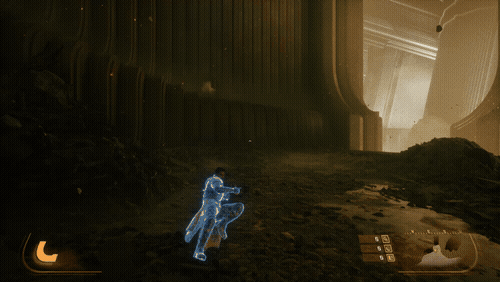

# Saros on Windows

[Watch the prologue recording and see the latest movement benchmark](https://portingpete.github.io/Saros-Recomp/).

This project tracks a Windows recompile using [AnyPS5](https://github.com/boykopovar/AnyPS5). The target is 120 FPS at a native render resolution of 2560 × 1440. Terra measures two 30-second prologue routes with simultaneous character movement and camera rotation. Each 10 FPS gain in their combined average gets a new recording and benchmark entry.

A separate frame-interpolation experiment produced 66.16 completed flips per second at native 1440p while the game advanced 33.11 frames per second. The benchmark includes both moving routes, six consecutive swapchain images and the renderer source changes. [Interpolation results and build instructions](windows/experiments/interpolation/README.md)

The Windows optical-flow build at 2560 × 1440 reached 122.04 and 123.15 driver-reported scanouts per second on the two moving routes. The game engine advanced at 29.80 and 29.91 FPS with five generated images per original frame. [Display timing, source patch and launcher](windows/experiments/optical-flow/README.md)

The Windows build scripts reproduce the executable, all 40 guest modules and the native display configuration from your local game files. The 30.96 FPS milestone includes its measured settings and a launcher for an assembled installation.

[Build and launch instructions](windows/README.md) · [Measured milestones](benchmarks.json) · [Movement video](media/prologue.mp4)
