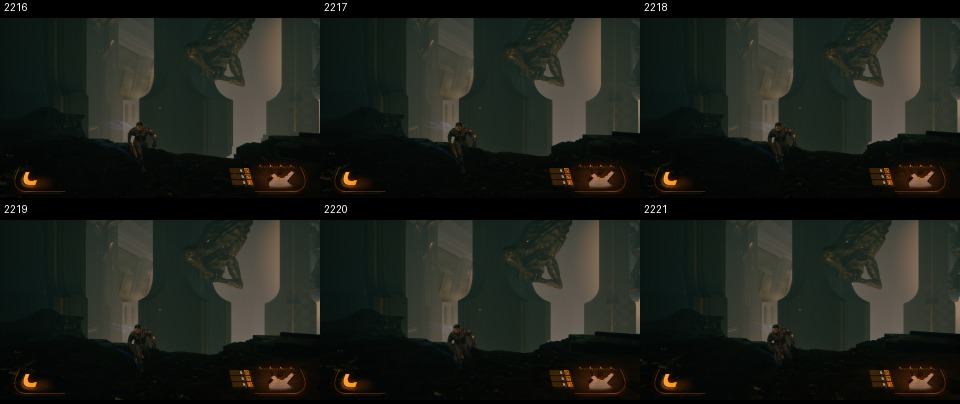

# Saros frame interpolation on Windows

Saros produced 66.16 completed flips per second at a native render resolution of 2560 × 1440 with its built-in FidelityFX interpolation enabled. Unreal advanced 33.11 game frames per second over the same two moving prologue routes. The quick test loads an existing prologue checkpoint. It ran on a Core i9-14900K and a GeForce RTX 5080. [Measurements and frame times](measurements.json)

| Internal resolution | Route | Game FPS | Completed flips/s | 95th percentile flip interval |
| --- | --- | ---: | ---: | ---: |
| Native 1440p | Tight turn | 34.53 | 69.03 | 32.44 ms |
| Native 1440p | Wide turn | 31.68 | 63.30 | 36.11 ms |
| Retail 41.666–60% range | Tight turn | 36.55 | 73.03 | 31.80 ms |
| Retail 41.666–60% range | Wide turn | 31.25 | 62.46 | 38.27 ms |

Both profiles produced a 2560 × 1440 Vulkan swapchain. Each process closed normally after two 30-second routes with zero dropped telemetry records. With interpolation disabled, the engine and flip counters agreed on both routes. With it enabled, the flip count doubled. PresentMon returned no physical display samples on the isolated test desktop. At the time of this measurement the published native-rendering milestone was 30.96 FPS. [Native benchmarks](../../../benchmarks.json)

The six images below came from consecutive calls to present during a separate tight-turn run. Both even and odd frames showed the character, scenery and HUD. All six original 2560 × 1440 images had distinct hashes.



The independently rebuilt renderer passed the Windows ABI check, entered the prologue and completed both moving routes at 65.70 and 54.12 flips/s. It loaded the Vulkan driver cache and rebuilt the game shader programs because its source stamp differed. The warmed benchmark above used the original measured renderer. [Rebuild and cache evidence](measurements.json)

A second run of the independently built renderer loaded 559 guest programs, 706 modules, 528 pipelines and 48.85 MB of Vulkan driver cache. It completed the tight turn at 67.40 flips/s and the wide turn at 56.59 flips/s. Both routes passed the movement and screenshot checks and the process closed normally. [Rebuild measurements](measurements.json)

## Build and launch

1. Reconstruct the source tree and generate the two headers from your local game files using the existing renderer instructions. Apply the experiment patch from the repository root before compiling the renderer. [Renderer instructions](../../renderer/README.md)

   ```powershell
   $experiment = (Resolve-Path windows/experiments/interpolation).Path
   git -C $src apply --check "$experiment/renderer.patch"
   if ($LASTEXITCODE) { throw "Patch check failed" }
   git -C $src apply "$experiment/renderer.patch"
   if ($LASTEXITCODE) { throw "Patch application failed" }
   ```

2. Compile the documented `kyty_gpu_dll_bundle` target and install its `kyty_gpu.prx` in the assembled installation's `libs` directory. The patch adds signed RGBA16 storage-image support, a separate memory-protection queue and a shutdown fix that keeps the guest GPU object alive through the final command drain. The original measurement used renderer SHA-256 `ae88b5a68da4cc9c95653d08c3b85d3aa17de398766688fd7cb269ccef53ac0c`. [Source hashes](source-hashes.json)

3. Build the native display overlay from the title instructions. Generate the additional profile from that overlay, using repak 0.2.3. The launcher uses Python 3.11 or newer and pywin32. [Windows installation instructions](../../README.md)

   ```powershell
   $play = "D:/Saros-Windows"
   $paks = "$play/app0/guest/content/paks"
   python -B "$experiment/build_performance_profile.py" --repak D:/tools/repak.exe --display-profile "$paks/pakchunk0-ps5_3_P.pak" --output "$paks/pakchunk0-ps5_5_P.pak" --mode selectable
   python -B windows/run_milestone.py --play $play --profile interpolation --check
   python -B windows/run_milestone.py --play $play --profile interpolation
   ```

The `interpolation` setting requests 100% render scale. Use `retail-interpolation` for the retail internal-resolution range, or `native-fxaa` for native rendering with FXAA and frame interpolation disabled. Each option uses the existing checkpoint, skips the startup movies and requests a 2560 × 1440 game window. The launcher writes a temporary settings file so the existing user configuration is preserved.

The benchmark used a warm pipeline cache with the prologue filter optimized. To recreate that shader from a matching privately generated cache, use Python 3.14 with xxhash, SPIRV-Tools and a C++20 compiler. The tool verifies the original filter and validates the rebuilt SPIR-V. Keep the input cache and select a new output file, then install the generated shader cache in the closed game's `_PipelineCache` directory.

```powershell
python -B "$experiment/optimize_saros_filter.py" D:/private/PPSA07631.shaders D:/private/optimized/PPSA07631.shaders --variant guarded-hoisted --spirv-tools D:/tools/spirv --guard-header "$src/core/kyty/graphics/shader/SpirvLoopFuel.h" --cxx D:/tools/mingw/bin/g++.exe
```
