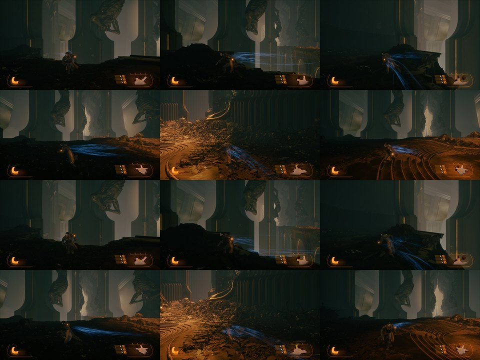

# Native 1440p gameplay and buffer uploads

Saros averaged **41.02 native gameplay FPS** over two 30-second prologue routes. An independent launch with the same renderer and settings averaged **38.51 FPS**. The first run exceeded the November 20 milestone of 30.96 FPS by 10.06 FPS. The repeat exceeded it by 7.55 FPS. Both used a Core i9-14900K and GeForce RTX 5080. [Route measurements](measurements.json) · [Per-frame timings](completed-flips.csv.gz)

| Upload path and run | Tight turn FPS | Wide turn FPS | Two-route mean |
| --- | ---: | ---: | ---: |
| Compute scatter | 43.20 | 38.83 | 41.02 |
| Compute scatter, repeat | 41.99 | 35.03 | 38.51 |
| Vulkan buffer copies | 38.14 | 34.40 | 36.27 |

The game rendered at 2560 × 1440 with both internal scale limits at 100%, FXAA enabled and FidelityFX frame interpolation disabled. Both routes ran from a prologue checkpoint with reduced shadows, global illumination, reflections and effects. The Windows client and six captured swapchain images per run measured 2560 × 1440. The test desktop ran at 360 Hz. [Gameplay profile](../interpolation/README.md)

The counters cover consecutive guest flip completions, including stalls. As an independent check, Unreal advanced at 43.18 and 38.82 ticks per second on the first run. On the repeat, the wide turn fell to 35.03 completed flips per second. The game saved new player positions on both routes, and the screenshots show the character and camera moving. The pad telemetry counter reported zero events. All three published processes closed normally with zero dropped telemetry records. [Counters, travel distances and frame hashes](measurements.json)

The first two rows show the tight and wide turns from the 41.02 FPS run. The last two rows show the repeat. Each row contains three captures spaced across the timed route.



An open AnyPS5 pull request suggested testing the cost of Vulkan copies on NVIDIA hardware. This renderer already groups uploads to multiple destinations into a compute dispatch. Sending those uploads through the existing transfer-command path reduced the two-route mean on this machine. The first run and the repeat both used the original compute path. The comparison with November 20 includes other renderer and profile changes. [AnyPS5 PR #20315](https://github.com/boykopovar/AnyPS5/pull/20315) · [Previous measurements](../../../benchmarks.json)

A separate build from the public renderer source passed the Windows ABI check and reached both gameplay routes. Its first launch loaded zero guest programs from the shader cache and averaged 37.22 FPS. The movement clip came from a separate pass after those measurements. Its 34 distinct images span 5.84 seconds and preserve the Vulkan capture timestamps to within 0.50 ms. The video is scaled to 1280 × 720 for distribution. [Gameplay video](../../../media/prologue.mp4) · [Build and recording evidence](measurements.json)

With a matching shader cache, the independently rebuilt renderer averaged **39.76 FPS**. It delivered 41.76 FPS on the tight turn and 37.75 FPS on the wide turn. The process loaded 523 guest programs, 670 modules, 489 pipelines and 47.97 MB of Vulkan driver cache. It finished both routes with zero telemetry drops and exited normally. [Warmed rebuild measurements](measurements.json)

## Build and play

Reconstruct the Windows renderer source, apply the interpolation renderer patch and then apply the optical experiment’s shutdown patch. Generate the headers and selectable gameplay profile from your local game installation using the linked instructions. The native upload experiment uses the renderer and the gameplay profile only. [Renderer reconstruction](../../renderer/README.md) · [Profile and shader cache](../interpolation/README.md) · [Shutdown patch](../optical-flow/exit-readbacks.patch)

From the repository root, apply the upload patch to the reconstructed source tree and rebuild the documented `kyty_gpu_dll_bundle` target. Install its `kyty_gpu.prx` under the game's `libs` directory.

```powershell
$patch = (Resolve-Path windows/experiments/native-uploads/upload-mode.patch).Path
git -C $src apply --check $patch
if ($LASTEXITCODE) { throw "Upload patch check failed" }
git -C $src apply $patch
if ($LASTEXITCODE) { throw "Upload patch failed" }
cmake --build "$work/build-renderer" --target kyty_gpu_dll_bundle --parallel 2
if ($LASTEXITCODE) { throw "Renderer build failed" }
python -B windows/run_milestone.py --play D:/Saros-Windows --profile native-upload-scatter --check
python -B windows/run_milestone.py --play D:/Saros-Windows --profile native-upload-scatter
```

The launcher skips startup movies and uses the existing gameplay checkpoint. To repeat the transfer comparison, select `--profile native-upload-copies`. The two options select the same FXAA quality profile and enable idle submission. The measured renderer passed the Windows ABI check. Its build used a separately relinked archive. The SHA-256 for that image and the public source patch are in the measurements. [Measurements](measurements.json)
