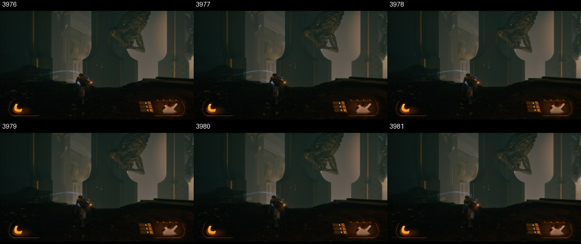

# Saros optical frame generation on Windows

The optical-flow layer reached **109.29 distinct driver-reported scanouts per second** across two moving prologue routes at 2560 × 1440. The engine advanced **28.39 frames per second**. The layer generated five intermediate images per engine frame.

| Presentation method | Route | Game FPS | Vulkan presents/s | Distinct scanouts/s | Median scanout interval | 95th percentile |
| --- | --- | ---: | ---: | ---: | ---: | ---: |
| Immediate submission to FIFO | Tight turn | 37.67 | 150.63 | 40.99 | 25.00 ms | 33.34 ms |
| Immediate submission to FIFO | Wide turn | 33.61 | 134.46 | 36.71 | 27.78 ms | 41.67 ms |
| Driver relative target of 8.33 ms | Tight turn | 29.43 | 117.56 | 33.16 | 33.33 ms | 47.22 ms |
| Driver relative target of 8.33 ms | Wide turn | 28.14 | 112.47 | 31.75 | 33.33 ms | 50.00 ms |
| Dedicated queue paced at 120 Hz | Tight turn | 20.10 | 80.38 | 56.75 | 16.67 ms | 33.34 ms |
| Dedicated queue paced at 120 Hz | Wide turn | 20.20 | 80.73 | 56.72 | 16.67 ms | 33.34 ms |
| Up to two presents pending | Tight turn | 29.80 | 119.22 | 84.42 | 11.11 ms | 22.22 ms |
| Up to two presents pending | Wide turn | 28.00 | 112.11 | 80.02 | 11.11 ms | 25.00 ms |
| GPU-ready, sixfold, up to two pending | Tight turn | 23.17 | 138.83 | 96.75 | 8.33 ms | 22.22 ms |
| GPU-ready, sixfold, up to two pending | Wide turn | 21.45 | 128.66 | 87.44 | 8.33 ms | 22.22 ms |
| GPU-ready, sixfold, up to four pending | Tight turn | 29.07 | 174.16 | 110.11 | 8.33 ms | 16.67 ms |
| GPU-ready, sixfold, up to four pending | Wide turn | 27.71 | 166.06 | 108.48 | 8.33 ms | 19.45 ms |

The layer spaces generated and original images on a second Vulkan queue in the same graphics family. Waiting for all four submissions gave 56.73 scanouts/s. Allowing two pending raised this to 82.22. The sixfold build waits for the GPU to finish each output image before submitting it at a target cadence of 180 Hz. It allows four pending on the eight-image 1440p swapchain. Both routes covered 30 seconds of simultaneous running and camera rotation. [Measurements](measurements.json)

The capture layer copies each image on the queue that presents it. The sixfold run recorded six timed gameplay captures, had zero dropped telemetry records and exited cleanly. The longest gap between reported scanouts was 41.67 ms on the tight turn and 361.13 ms on the wide turn. Earlier trials encountered a device loss with a different capture queue and a guest readback after renderer shutdown. The latter led to an exit fix that drains issued GPU work and keeps the readback worker available to guest threads until Windows terminates the process. [Shutdown patch](exit-readbacks.patch)

The host was a Core i9-14900K with a GeForce RTX 5080, driver 617.14 and a 360 Hz monitor. The game rendered at 100% scale with FXAA and its own frame interpolation disabled. A separate Vulkan layer ran optical flow at a scale of 0.75. The Windows client and Vulkan images measured 2560 × 1440 on an isolated desktop. The engine rate comes from Unreal's frame counter. The Vulkan rate counts successful presentation calls. The scanout rate counts distinct positive first-pixel-out timestamps reported by the driver. That stage tracks transmission to display hardware. The driver did not expose first-pixel-visible timing. [Vulkan stage definitions](https://docs.vulkan.org/refpages/latest/refpages/source/VkPresentStageFlagBitsEXT.html)

The compressed CSV contains all 45,494 successful presents from the twelve route windows. Times are nanoseconds relative to the start of each route. Empty timestamps represent complete reports with a zero timestamp. The original image has index −1. In the four-pending sixfold run, 6,562 of 10,212 successful presents had positive stage timestamps. Two tight-turn presents shared one timestamp, leaving 6,561 distinct scanouts. [Per-present evidence](per-present.csv.gz)

Six consecutive original and generated swapchain images from the tight turn show the moving character, scenery and HUD. All six 2560 × 1440 source images had different hashes. The contact sheet shows the images submitted to Vulkan.



## Build and launch

Use an assembled game installation with the selectable presentation overlay, the rebuilt renderer and a prologue checkpoint. The optical layer reads the shader resource library from an existing Lossless Scaling installation. This Windows experiment was tested with MinGW-w64 GCC 15, CMake, Ninja, Vulkan-Headers 1.4.335 and the RTX 5080 driver listed above. The patch uses Vulkan present timing and present ID 2. [Saros installation and selectable profiles](../interpolation/README.md) · [Windows Vulkan layer](https://github.com/56TR/lsfg-vk-windows/blob/b03458e44eb5cc5a87537b3743f52617974e2389/WINDOWS.md) · [Lossless Scaling](https://store.steampowered.com/app/993090/LosslessScaling/)

Apply the shutdown patch to the reconstructed AnyPS5 source tree after the interpolation renderer patch, then rebuild its documented Windows renderer target. The patch changes the process-exit path in the Kyty shim. [Renderer build steps](../interpolation/README.md)

```powershell
$experiment = (Resolve-Path windows/experiments/optical-flow).Path
git -C $src apply --check "$experiment/exit-readbacks.patch"
if ($LASTEXITCODE) { throw "Renderer patch check failed" }
git -C $src apply "$experiment/exit-readbacks.patch"
if ($LASTEXITCODE) { throw "Renderer patch failed" }
```

Run these commands from the Saros-Recomp repository in a PowerShell session with the compiler, CMake and Ninja on PATH. Set VULKAN_SDK to the installed SDK directory containing Include.

```powershell
$experiment = (Resolve-Path windows/experiments/optical-flow).Path
git clone https://github.com/56TR/lsfg-vk-windows.git lsfg-vk-windows
git -C lsfg-vk-windows checkout --detach b03458e44eb5cc5a87537b3743f52617974e2389
git -C lsfg-vk-windows apply --check "$experiment/paced-output.patch"
if ($LASTEXITCODE) { throw "Optical patch check failed" }
git -C lsfg-vk-windows apply "$experiment/paced-output.patch"
if ($LASTEXITCODE) { throw "Optical patch failed" }
$env:CPATH = (Join-Path $env:VULKAN_SDK "Include")
cmake -S lsfg-vk-windows -B optical-build -G Ninja -DCMAKE_BUILD_TYPE=Release -DCMAKE_CXX_COMPILER=g++.exe -DLSFGVK_BUILD_UI=OFF -DLSFGVK_BUILD_CLI=OFF -DLSFGVK_BUILD_VK_LAYER=ON
if ($LASTEXITCODE) { throw "Optical layer configuration failed" }
cmake --build optical-build --target lsfg-vk-layer
if ($LASTEXITCODE) { throw "Optical layer build failed" }
python "$experiment/run_optical.py" --play "D:/Games/Saros/play" --layer "optical-build/lsfg-vk-layer/liblsfg-vk-layer.dll" --check
```

Use the same launcher command without `--check` to play. Pass `--lossless-dll` if Steam uses another library location. The launcher selects the native FXAA profile, skips the startup movies and creates a temporary layer manifest and configuration for the game process. The existing checkpoint supplies the gameplay starting point. The upstream layer and its patch use the GPL-3.0-or-later license. [Windows launcher](run_optical.py) · [Build identities](source.json) · [Upstream license](https://github.com/56TR/lsfg-vk-windows/blob/b03458e44eb5cc5a87537b3743f52617974e2389/LICENSE.md)
