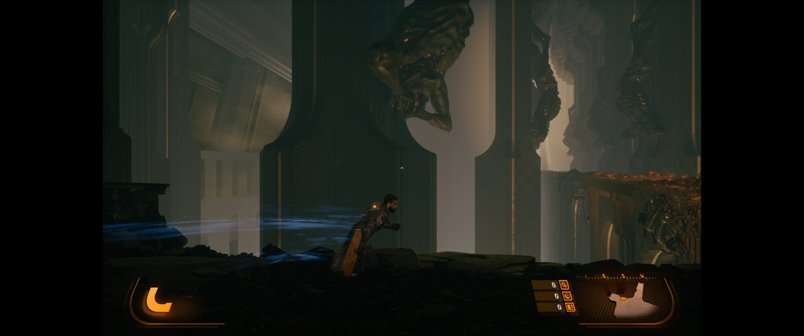
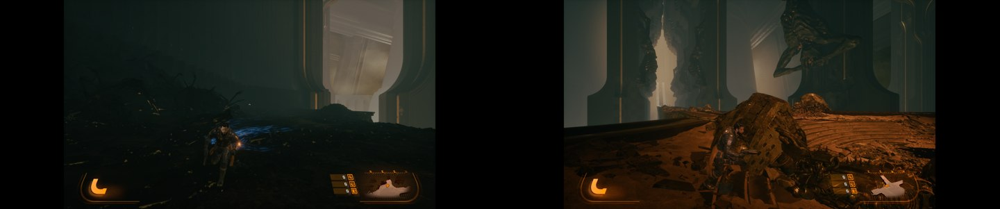

# November 27 Windows renderer experiment

The x28 renderer averaged **63.21 completed flips per second** across two moving prologue routes on a Core i9-14900K and RTX 5080. It gained **9.66 FPS (18.0%)** over the interleaved control. The tight turn averaged 69.15 FPS and the wide turn averaged 57.27 FPS.

| Renderer | Combined FPS in each run | Tight turn, pooled FPS | Wide turn, pooled FPS | Both routes, pooled FPS |
| --- | --- | ---: | ---: | ---: |
| g100w (control) | 53.82, 53.91, 52.90 | 57.51 | 49.58 | 53.54 |
| g100x14 | 61.32, 61.06, 65.59 | 67.71 | 57.59 | 62.65 |
| g100x28 | 61.61, 62.88, 65.13 | 69.15 | 57.27 | 63.21 |

Each launch ran a tight sprint circle followed by a wider circle after a forward run. The harness counted consecutive VideoOut flip intervals for 30 seconds per route. Each pooled rate divides the sum of interval counts by the sum of measured seconds, including stalls. All 18 windows recorded player movement. All nine launches exited normally and reported zero telemetry drops. The native FXAA profile requested 2560 × 1440 output, and the guest reported both internal scale limits at 100%. Each build used its own warm cache and settings, so these measurements compare whole configurations. [Run counts, frame times, travel, settings and binary hashes](measurements.json)

The renderer's prediction guard reported skipped compute dispatches in every launch. Its last sample recorded 3–6 skips on the control, 4–5 on x14 and 1–10 on x28. A wrong prediction can suppress work that contributes to the image. The flip counts establish throughput for these configurations. Whether they produced equivalent images throughout both routes remains open.



Frame 1400 comes from a separate x28 tight-turn run with Vulkan swapchain capture enabled. The nine timing runs have no matching gameplay movie or independent engine tick measurement in their reports. The latest recorded movement milestone is 51.82 FPS. [Recorded milestones](../../../benchmarks.json)

## Rebuild the experimental source

The patch covers the local renderer changes through November 27, including work after the measured x28 build. It changes 76 files relative to the public v0.2.0 renderer source. The changes cover GPU readback and buffer sharing, command submission, shader generation and instrumentation. The measured binaries are identified individually in the run data. The base kit contains the AnyPS5, Kyty and third-party license notices. [Renderer patch](renderer.patch) · [v0.2.0 renderer source ZIP](https://github.com/portingpete/Saros-Recomp/releases/download/v0.2.0-windows-drop-in/Saros-Windows-Renderer-Source.zip)

Download the ZIP and extract it to a new directory outside any Git checkout. From a checkout of Saros-Recomp, set the patch path in PowerShell, then switch to the extracted directory. Verify the original kit before applying the patch.

```powershell
$patch = (Resolve-Path windows/experiments/renderer-nov27/renderer.patch).Path
Set-Location D:/Saros-renderer
python -B verify_source.py
if ($LASTEXITCODE) { throw "Base source verification failed" }
git -C source -c core.autocrlf=false apply --check --whitespace=nowarn "$patch"
if ($LASTEXITCODE) { throw "Patch does not match the base source" }
git -C source -c core.autocrlf=false apply --whitespace=nowarn "$patch"
if ($LASTEXITCODE) { throw "Patch application failed" }
```

The ZIP SHA-256 is `1a17a4dfc996aeb85307777284e3788f8baf3e9b4c9b31713f236f601876ba6b`. The patch SHA-256 is `7be0cebb9e9a4782fc5f527aab498590ba3754dc86d47579a72000e4dedb3f90`. Follow the kit's **Build tools** section to set `LLVM_BIN` and `TOOLS_BIN` and prepare `$glslang` and `$validator`. From the extracted directory, build and test the patched renderer.

```powershell
python -B build.py --work . --llvm-bin "$env:LLVM_BIN" --tools-bin "$env:TOOLS_BIN" --glslang "$glslang" --jobs 8
python -B check.py .
python -B check_shader.py . --validator "$validator"
```

## Checks on the published patch

A clean rebuild produced `kyty_gpu.prx` with SHA-256 `3a8dcee145eb6a7bc296ef71ec843838c5aa25f433673eef0e37bfed19ed1526`. It passed ABI and shader-module forwarding tests, generated two valid synthetic compute shaders, and rejected a malformed module.

The first launch started with an empty cache. It recorded 850 flips and ended without a completed route report. A second launch reused that cache, enabled swapchain capture and used the x28 settings with the shader cache stamp override removed. It completed both routes at **55.44 FPS**, recorded movement on each and exited normally with zero telemetry drops. This single capture run used a different cache and binary from the three-run comparison above. [Rebuild measurements](measurements.json)



Static review found a compute barrier that can be lost after a zero-sized dispatch, and Win32 thread APIs outside a platform guard in the fault census. These findings remain open in this experimental snapshot.
